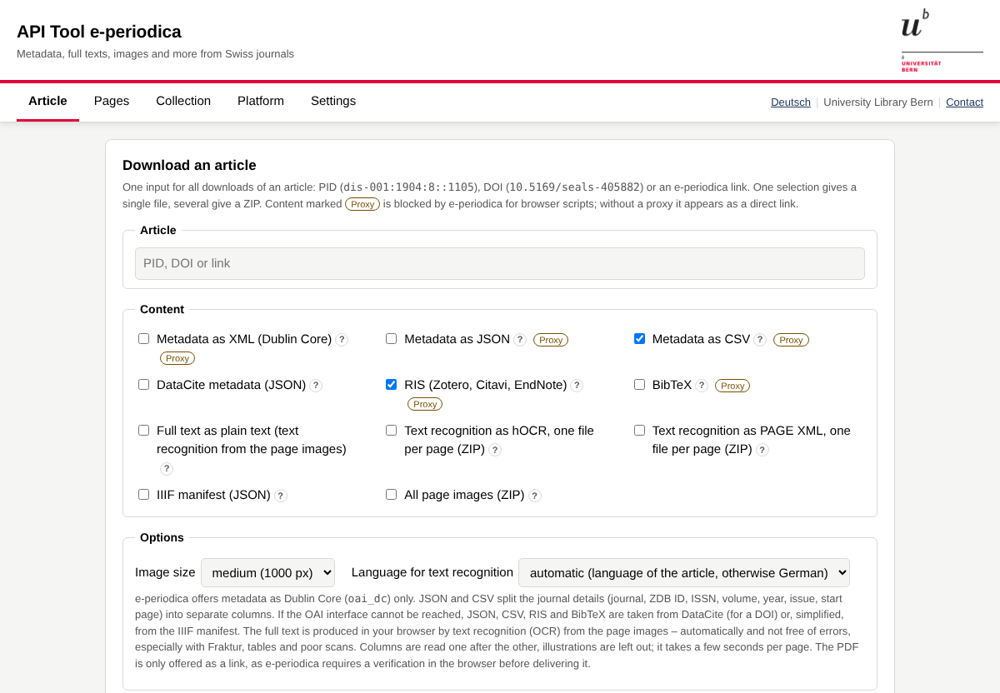

# Data tool for e-periodica

## Contents

- [About](#about)
- [What can I download?](#what-can-i-download)
- [How to use](#how-to-use)
- [Terms of use and licence](#terms-of-use-and-licence)
- [Credits](#credits)

Download metadata, full texts and images of Swiss journals from [e-periodica](https://www.e-periodica.ch/), directly in the browser, without programming and without installation.

**▶ Open the tool:** [English](https://k-woitas.github.io/eperiodica-explorer/) · [Deutsch](https://k-woitas.github.io/eperiodica-explorer/de/)

This repository replaces [e-periodica-access](https://github.com/k-woitas/e-periodica-access).

## About

e-periodica, run by ETH Library Zurich, makes a large number of digitised Swiss journals from the 18th century to the present freely available and offers open interfaces (OAI-PMH, IIIF) for research and teaching. This tool makes these interfaces usable through a simple form: enter an article, choose the content, download.

## What can I download?

| Section | Content | Formats |
|---|---|---|
| **Article** one article by PID, DOI or link | Metadata (Dublin Core) | XML¹, JSON, CSV |
| | DataCite metadata | JSON |
| | Citation | RIS, BibTeX |
| | Full text² | plain text, hOCR, PAGE XML (one file per page) |
| | Digital copy | IIIF manifest (JSON), all page images (ZIP); the PDF is offered as a link |
| **Pages** single pages or ranges, e.g. `2-4` | Text², images | TXT, hOCR, PAGE XML, JPEG; image size, region, rotation, mirroring and colour selectable |
| **Collection** a set (journal or DDC subject group), optionally a time period | Metadata of all records¹ | CSV, JSON, XML per record, PID list, RIS, BibTeX |
| | Optional per article | full text² (plain text, hOCR, PAGE XML), IIIF manifest |
| **Platform** | Interface details¹, metadata format, searchable list of all sets | on screen |

Several selections are bundled into one ZIP file with a `SOURCE.txt` that names the source of every file and a suggested citation. The «?» next to each checkbox shows where the content comes from.

¹ Requires a CORS proxy, as e-periodica blocks its OAI interface for browser scripts. Without one, the tool offers a direct link instead, takes metadata as JSON/CSV and citations from DataCite (or, simplified, from the IIIF manifest), and harvesting a collection is not possible. See [PROXY.md](PROXY.md). 
² Produced in your browser by text recognition (OCR, [Tesseract.js](https://github.com/naptha/tesseract.js)) from the page images: columns are read one after the other, illustrations are left out. Languages: German (Antiqua and Fraktur), French, Italian, English, Latin. Generated automatically, may contain errors.

## How to use

Open the [online version](https://k-woitas.github.io/eperiodica-explorer/), or download [`index.html`](index.html) (English) or [`de/index.html`](de/index.html) (German) and open the file in your browser. Each version is a single self-contained HTML file. No installation, no account.

All requests go directly from your browser to e-periodica, to the IIIF image server of ETH Library and to DataCite; no data is passed on to third parties. Exceptions: a CORS proxy you enter yourself, and the text recognition Tesseract.js (program and language data), which is loaded from cdn.jsdelivr.net only when you request a full text. Settings are stored only in your browser.

To unlock all functions (OAI-PMH metadata, harvesting, current platform details), set up your own CORS proxy as described in [PROXY.md](PROXY.md).

## Terms of use and licence

The code in this repository is published under the [MIT License](LICENSE).

The retrieved content is subject to the [terms of use of e-periodica](https://www.e-periodica.ch/digbib/terms) and to the rights statement in the respective record. In particular:

- The documents are freely available for private, non-commercial and educational purposes. Files may be passed on with a correct citation and a reference to e-periodica; the tool adds a suggested citation to `SOURCE.txt`.
- Publishing images in print, online or on social media requires the prior consent of the rights holders.
- Systematic storage of parts or all of the offering on other servers requires the written consent of the rights holders and ETH Library. Harvest only what your project needs.

The PDF download is not offered, as e-periodica delivers PDFs only after a verification in the browser.

## Credits

Developed by Kathi Woitas at the [University Library Bern, Digital Scholarship](https://www.ub.unibe.ch/services/digital_scholarship/index_eng.html), with the support of Claude (Anthropic). As of October 2026.

Questions, suggestions and bug reports: via the «Contact» link in the tool or as a [GitHub issue](https://github.com/k-woitas/eperiodica-explorer/issues).
